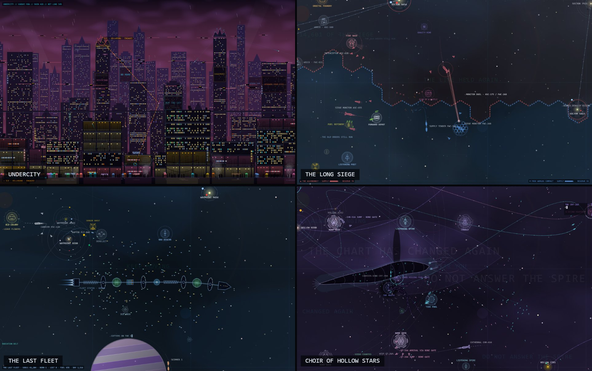
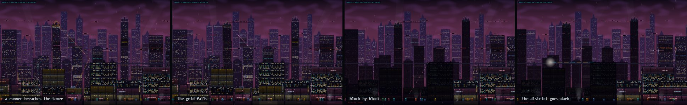
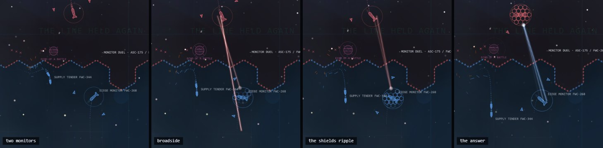
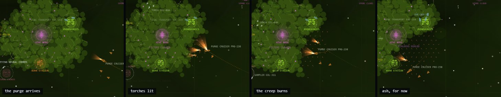
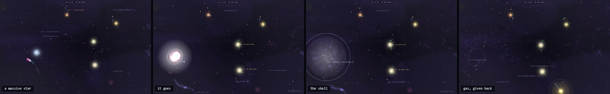

<h1 align="center">Vivarium</h1>

<p align="center">
  <b>Small worlds that run behind a web page.</b><br>
  Living algorithmic art. An idle game that plays itself.
</p>

<p align="center">
  <a href="https://aesthetic-backgrounds-library.vercel.app"><b>Open the studio →</b></a>
  &nbsp;·&nbsp; <a href="#put-one-on-your-site">Put one on your site</a>
  &nbsp;·&nbsp; <a href="#the-worlds">The worlds</a>
  &nbsp;·&nbsp; <a href="#documentation">Docs</a>
</p>



Vivarium is a set of animated backgrounds for websites. They are not loops. Each one is a small simulation with its own rules, and the rules make things happen.

A war room tracks a front that has not moved in forty years. A city in the rain loses its power one block at a time. Dwarves dig a kingdom into a mountain. Mages raise towers on lines of power. A wyrm sleeps on a spire above a valley, until it wakes. A factory builds itself, a castle walks across painted country, and a tiny solar system lives out its last twenty-two minutes, over and over.

You can read it two ways:
- **Living algorithmic art.** Generative pieces that do not stop or repeat. The same seed always plays the same story, so a link is an exact world.
- **An idle game with no player.** Economies, sieges, harvests, and wars run on their own. Watch for a minute, or leave the tab open for a week and look back at what happened.

It is also an experiment. Most of the code here was written with frontier AI coding agents, one world at a time. Each world is a hard brief: a simulation, a renderer, pacing, sound, and taste, all in one file tree. It is a fun way to see what the models can do, and where they still fail.

They still behave like backgrounds: the text over them stays readable, they pause when the tab is hidden and calm down under reduced motion, and they stay small (the engine is about 16 KB, and each world loads only when it is shown).

## Contents

- [Things happen](#things-happen)
- [The worlds](#the-worlds), [instruments](#instruments), and [basics](#basics)
- [The studio](#the-studio)
- [Put one on your site](#put-one-on-your-site)
- [Documentation](#documentation)

## Things happen

Every world has its own events, not just its own colors. Here are a few, frame by frame.

**Undercity.** A runner breaches a corp tower, and the district's grid fails outward from it, block by block.



**The Long Siege.** Two siege monitors trade broadsides across the front, and hex shields light up where the beams land.



**Hive Bloom.** A purge fleet lights its torches and burns the creep back to ash. It will grow back.



**Cradle of Suns.** A massive star dies, and its shell carries the gas back out to make the next ones.



## The worlds

A few seconds of each. Click one for what happens in it, and [OPTIONS.md](docs/OPTIONS.md) for how to tune it.

<table>
<tr>
<td width="33%" valign="top"><a href="docs/WORLDS.md#the-sector-map"></a><br><b><a href="docs/WORLDS.md#the-sector-map">The Void Sector</a></b><br>A living tactical chart: fleets, convoys, gates, raids, and an economy.</td>
<td width="33%" valign="top"><a href="docs/WORLDS.md#six-more-universes"></a><br><b><a href="docs/WORLDS.md#six-more-universes">Saltwind Reach</a></b><br>A poor mining frontier: claims, smugglers, and dust fronts.</td>
<td width="33%" valign="top"><a href="docs/WORLDS.md#six-more-universes"></a><br><b><a href="docs/WORLDS.md#six-more-universes">Choir of Hollow Stars</a></b><br>Emptied stars that sing to each other, and leviathans.</td>
</tr>
<tr>
<td width="33%" valign="top"><a href="docs/WORLDS.md#six-more-universes"></a><br><b><a href="docs/WORLDS.md#six-more-universes">The Long Siege</a></b><br>A front held hex by hex: artillery, monitor duels, truces.</td>
<td width="33%" valign="top"><a href="docs/WORLDS.md#six-more-universes"></a><br><b><a href="docs/WORLDS.md#six-more-universes">Hive Bloom</a></b><br>A creep spreading over the colonies, and the fleets that burn it.</td>
<td width="33%" valign="top"><a href="docs/WORLDS.md#six-more-universes"></a><br><b><a href="docs/WORLDS.md#six-more-universes">The Last Fleet</a></b><br>An ark and its flotilla, running from pursuers.</td>
</tr>
<tr>
<td width="33%" valign="top"><a href="docs/WORLDS.md#six-more-universes"></a><br><b><a href="docs/WORLDS.md#six-more-universes">Cradle of Suns</a></b><br>A time-lapse from gas to stars to civilizations.</td>
<td width="33%" valign="top"><a href="docs/WORLDS.md#undercity"></a><br><b><a href="docs/WORLDS.md#undercity">Undercity</a></b><br>A city in the rain that loses its power block by block.</td>
<td width="33%" valign="top"><a href="docs/WORLDS.md#shieldwall"></a><br><b><a href="docs/WORLDS.md#shieldwall">Shieldwall</a></b><br>Pixel armies meeting at a ford, from the side or above.</td>
</tr>
<tr>
<td width="33%" valign="top"><a href="docs/WORLDS.md#ages"></a><br><b><a href="docs/WORLDS.md#ages">Ages</a></b><br>A thousand years of a continent: towns, roads, kingdoms.</td>
<td width="33%" valign="top"><a href="docs/WORLDS.md#war-table"></a><br><b><a href="docs/WORLDS.md#war-table">War Table</a></b><br>A parchment war map with painted tokens and inked orders.</td>
<td width="33%" valign="top"><a href="docs/WORLDS.md#wyrmspire"></a><br><b><a href="docs/WORLDS.md#wyrmspire">Wyrmspire</a></b><br>A valley under a sleeping wyrm, until it wakes.</td>
</tr>
<tr>
<td width="33%" valign="top"><a href="docs/WORLDS.md#deephold"></a><br><b><a href="docs/WORLDS.md#deephold">Deephold</a></b><br>Dwarves digging a kingdom into a mountain.</td>
<td width="33%" valign="top"><a href="docs/WORLDS.md#leylines"></a><br><b><a href="docs/WORLDS.md#leylines">Leylines</a></b><br>Mages raising towers on lines of power.</td>
<td width="33%" valign="top"><a href="docs/WORLDS.md#silent-running"></a><br><b><a href="docs/WORLDS.md#silent-running">Silent Running</a></b><br>A sea war on a sonar chart: convoys, raiders, destroyers.</td>
</tr>
<tr>
<td width="33%" valign="top"><a href="docs/WORLDS.md#foundry"></a><br><b><a href="docs/WORLDS.md#foundry">Foundry</a></b><br>A factory that builds itself.</td>
<td width="33%" valign="top"><a href="docs/WORLDS.md#brasswind"></a><br><b><a href="docs/WORLDS.md#brasswind">Brasswind</a></b><br>A skyport city of brass and steam.</td>
<td width="33%" valign="top"><a href="docs/WORLDS.md#ironhaze"></a><br><b><a href="docs/WORLDS.md#ironhaze">Ironhaze</a></b><br>A city of iron and smoke in five planes of fog.</td>
</tr>
<tr>
<td width="33%" valign="top"><a href="docs/WORLDS.md#sandsea"></a><br><b><a href="docs/WORLDS.md#sandsea">Sandsea</a></b><br>A spice crawler on the open sand, and the worm that comes.</td>
<td width="33%" valign="top"><a href="docs/WORLDS.md#windtrap"></a><br><b><a href="docs/WORLDS.md#windtrap">Windtrap</a></b><br>A desert hold cut into a cliff, in cutaway.</td>
<td width="33%" valign="top"><a href="docs/WORLDS.md#walking-castle"></a><br><b><a href="docs/WORLDS.md#walking-castle">Walking Castle</a></b><br>A wizard's castle on hen's legs, walking painted country.</td>
</tr>
<tr>
<td width="33%" valign="top"><a href="docs/WORLDS.md#war-rig"></a><br><b><a href="docs/WORLDS.md#war-rig">War Rig</a></b><br>A tanker run across the waste with a war party behind it.</td>
<td width="33%" valign="top"><a href="docs/WORLDS.md#traction"></a><br><b><a href="docs/WORLDS.md#traction">Traction</a></b><br>Predator cities on tracks, hunting small towns.</td>
<td width="33%" valign="top"><a href="docs/WORLDS.md#last-loop"></a><br><b><a href="docs/WORLDS.md#last-loop">Last Loop</a></b><br>A tiny solar system's last 22 minutes, over and over.</td>
</tr>
<tr>
<td width="33%" valign="top"><a href="docs/WORLDS.md#blockade"></a><br><b><a href="docs/WORLDS.md#blockade">Blockade</a></b><br>A fleet holding a planet, seen from orbit.</td>
<td width="33%" valign="top"><a href="docs/WORLDS.md#titan-dock"></a><br><b><a href="docs/WORLDS.md#titan-dock">Titan Dock</a></b><br>Giant robots against what comes out of the rift.</td>
<td width="33%" valign="top"><a href="docs/WORLDS.md#saber-front"></a><br><b><a href="docs/WORLDS.md#saber-front">Saber Front</a></b><br>Clone Wars ground battles, seen from a ridge.</td>
</tr>
</table>

## Instruments

The same idea, applied to other screens. More in [the worlds](docs/WORLDS.md#instruments-from-other-worlds).

| | |
| --- | --- |
|  **Sonar.** A submarine's passive waterfall. |  **Approach radar.** The sweep paints aircraft onto fading phosphor. |
|  **Seismograph.** Station pens tremble until a quake's waves sweep down the stack. |  **Abyssal scanner.** Marine snow and bioluminescent animals. |
|  **Martian weather radar.** Dust storm cells drift over Jezero. |  **Petri dish.** Artificial life under a fluorescence microscope. |

## Basics

Not every site wants a story. Calm presets for product pages, built from the same layer library and tuned behind real text:

| calm-mesh | aurora-night | terminal-rain | fireflies |
| --- | --- | --- | --- |
|  |  |  |  |
| **deep-field** | **flow-lines** | **paper-grid** | **nebula-drift** |
|  |  |  |  |

## The studio

The [studio](https://aesthetic-backgrounds-library.vercel.app) is where you pick a world, roll seeds, and tune it. It also:
- **Makes your own universe.** Describe a book, a film, or a game, copy the prompt into any AI, paste back what it writes.
- **Plays sound.** Generated, no audio files, about 6 KB. Press **M**.
- **Lets you touch a world.** A click nudges it, and the nearest thing answers in its own way.
- **Keeps a journal.** Sightings from common to legendary, moments kept as pictures and clips, and what happened while you were away. Press **J**.
- **Makes wallpapers.** A live link for Lively, Plash, or KDE, an offline file, Wallpaper Engine packages, and phone stills and videos.


All of it in [docs/STUDIO.md](docs/STUDIO.md).

## Put one on your site

The quickest way: open the [studio](https://aesthetic-backgrounds-library.vercel.app), pick one, and click **Copy prompt for your AI**. Paste it into Claude, ChatGPT, Cursor, or v0. The prompt carries the exact configuration and the few rules that keep it right.

Or drop it in yourself.

**As a web component:**

```html
<script type="module" src="https://unpkg.com/space-background-engine/dist/element.js"></script>
<vivarium-bg skin="void-tactical" seed="orion-7"></vivarium-bg>
```

The element has two names: `<vivarium-bg>`, and `<bg-engine>` from before the project had one. They are the same element and take the same attributes.

Pick a skin, derive a palette from your brand color, and dial the presence down:

```html
<bg-engine skin="matrix-rain" palette="#ff7a1a" intensity="0.6"></bg-engine>
```

**From JavaScript:**

```ts
import { mount } from 'space-background-engine';

// Full-page background behind everything
mount(document.body, { skin: 'void-tactical', seed: 'orion-7', options: { universe: 'saltwind' } });

// Or inside a positioned container
mount('#hero', { skin: 'undercity', intensity: 0.6 });
```

`mount()` returns a handle with `canvas`, `root`, `pause()`, `resume()`, `renderOnce()`, `onEvent()`, and `destroy()`. Page content stays fully clickable, because the whole background stack has `pointer-events: none`.

## Documentation

| | |
| --- | --- |
| [The worlds](docs/WORLDS.md) | Every world in detail: what you see, what happens, what each seed changes. |
| [Options](docs/OPTIONS.md) | Each world's options. |
| [The studio](docs/STUDIO.md) | Make your own universe, sound, clicking a world, the journal, wallpapers. |
| [Wallpapers](docs/WALLPAPERS.md) | Step-by-step guides for Lively, Wallpaper Engine, Plash, KDE, and phones. |
| [Reference](docs/REFERENCE.md) | Installation, presets, frameworks, configuration, scenes and layers, events, writing a skin, local development. |
| [Making a world](docs/AUTHORING.md) | The kit, the brief, and the checks, for building a world by hand or with an AI agent. |
| [Architecture](docs/ARCHITECTURE.md) | How the internals fit together. |
