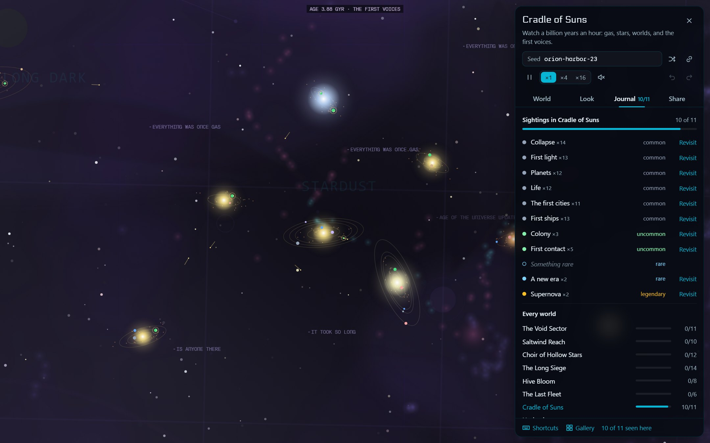

# The studio

What you can do with a world beyond watching it: make your own universe, hear it, touch it, keep a journal, and set it as your wallpaper. The studio is at [aesthetic-backgrounds-library.vercel.app](https://aesthetic-backgrounds-library.vercel.app).

- [Make it your universe](#make-it-your-universe)
- [Sound](#sound)
- [Touching a world](#touching-a-world)
- [The journal](#the-journal)
- [As your wallpaper](#as-your-wallpaper)

## Make it your universe

You don't write a universe by hand:

1. In the studio, open **Universe → Make your own** and type a book, a film, a game, your tabletop setting, or a few lines about a world.
2. Click **Copy the prompt** and paste it into any AI.
3. Paste back what it writes, and the map becomes that world.

### What happens here

What makes a universe play differently is its *mechanics*: small plugins that spawn fleets, steer them, fight, break things, and draw on the map. A universe lists the ones it runs and how they're tuned. In the studio, under **What happens here**, you can switch any of them on or off and tune them. There are more than thirty built in. They include:
- the economy, raids, police, gates, and relays
- mining, wardens, and storms
- songs, leviathans, the Mouth, and echoes
- a front held cell by cell, spotted artillery, monitor duels, truces, and minefields
- the bloom, spores, and purges
- the ark, its flotilla, pursuers, and skimmers
- the lives of stars and of the civilizations around them

Writing a new one takes a few dozen lines:

```ts
import { registerMechanic, steerToward } from 'space-background-engine/skins/void-tactical';

registerMechanic({
  id: 'patrol',
  label: 'Patrols',
  description: 'Fighters warp in at one structure and sweep to another.',
  schema: { rate: { type: 'number', min: 0.1, max: 2, default: 0.5, label: 'Per minute' } },
  create(api, p) {
    let next = api.t + 5;
    return {
      update() {
        const [a, b] = api.structures();
        if (api.t < next || !a || !b) return;
        next = api.t + 60 / Number(p.rate);
        api.spawnFleet({ x: a.x, y: a.y, vx: 0, vy: 0 }, {
          cls: 'fighter',
          warpIn: true,
          steer: (f, dt) => {
            steerToward(f.ships[0], b.x, b.y, 110, 6, dt);
            if (Math.hypot(b.x - f.ships[0].x, b.y - f.ships[0].y) < 30) api.release(f);
          },
        });
      },
    };
  },
});

mount(document.body, { skin: 'void-tactical', options: { universe: 'saltwind', mechanics: [{ use: 'asteroids' }, { use: 'patrol' }] } });
```

`options.mechanics` replaces the universe's own list. Leave it out to keep that list. How the pieces fit (the camera, the event bus, shared services like the economy and the war state) is in [docs/ARCHITECTURE.md](ARCHITECTURE.md).

## Sound

The worlds can be heard as well as seen. Sound is opt-in and generated, with no audio files, and adds about 6 KB:

```ts
import { createSoundscape } from 'space-background-engine/audio';

const sound = createSoundscape({ palette: 'choir' });
sound.attach(handle);
playButton.onclick = () => sound.start(); // browsers allow audio only after a click
```

Explosions boom where they happen across the screen. A raid brings a siren and a capture rings a bell. In the Choir, the songs are low voices answering each other, and in Undercity the thunder comes a moment late. Most worlds have their own palette and drone (the eleven newest borrow the sector map's for now). In the studio, press the speaker (or **M**).

## Touching a world

In Wyrmspire, Deephold, Leylines, and every world built on the world kit (Silent Running, Foundry, and the eleven after them), a click nudges the world, and the nearest thing answers in its own way. A ring shows where you touched; the world says what happened in its own text.

- **Wyrmspire.** Click the spire and a stone wakes the wyrm (it may come down angry). Click a raiding wyrm and the bells turn it for home. The town rings for a feast, a village goes out for wood and builds, and the open land sends a caravan down the road.
- **Deephold.** Click the slopes and traders set out for the nearest hold. Click a hold's rooms and the bell rings for a feast. Click plain rock and a vein of iron, gold or gems shows itself; the miners will find it (one every half minute).
- **Leylines.** Click a tower and light runs down its lines. A village builds a cottage. Open land gathers an arcane storm, where this realm has storms.
- **Silent Running.** A sonobuoy drops and listens; if it hears a submarine, the nearest destroyer comes.
- **Foundry.** A click on an ore field orders a new mine; a click on a machine puts it on overtime.
- **Brasswind.** A factory blows its whistle, other buildings ring their bells, and a flare in the sky brings the nearest ship in to a free mast.
- **Ironhaze.** A ship sounds its horn, a walker its siren, and a clock strikes. The near rooftops set the foundries pouring; anywhere else, a flare goes up and a ship turns its searchlight on.
- **Sandsea** and **Windtrap.** A click on the sand plants a thumper, and something may come. In Sandsea, a worm already showing sign turns for it. In Windtrap, a click in a chamber makes the people there look up.
- **Walking Castle.** The castle's door turns to the next place and opens. The near grass sends up larks (fireflies at night), the far fields get a gust, and the sky a shooting star at night or a smoke ring from the castle.
- **War Rig.** The rig's lancer throws at the nearest car, or a flare goes up.
- **Traction.** A roaming town becomes the city's next prey, the mud sends up a flare that brings a town to look, and the sky scatters the crows.
- **Last Loop.** The shy moon jumps, the sun flares where you clicked, a click near a world sets the traveller's course for it, and empty space gets a sweep of the signalscope.
- **Blockade.** On the planet, the nearest capital ship sends a shuttle down to the mark. In space, a fighter wing (or a frigate) goes to investigate.
- **Titan Dock.** A mech in its bay runs a systems check, a monster draws the shore guns, and the water gets a flare that turns the patrols' lights on it.
- **Saber Front.** A capital ship fires a strike on the ground where you clicked.

The world waits a few seconds between nudges. Nudges are not part of the seed, so a replay of the same seed does not repeat them. On your own site, turn them on with `nudges: true`; on the wallpaper page, `&i=1` turns them on with zoom and pan.

## The journal

Things happen whether you are watching or not, so the studio keeps a journal. It keeps it quietly: nothing pops up over the world while it plays. The worlds tell their own story on the canvas, and the Journal tab gets a *new* mark when there is something to look at.



- **Sightings.** Every world has its own list of things that can happen in it, from common to legendary: a supernova in the Cradle, a gate surge in the Void, Mayday on the approach radar. The first time you see one, it is kept with its seed and the time. The everyday ones are named up front; the rare ones stay hidden until you have seen them.
- **Moments.** The first time something uncommon or rarer happens, the journal keeps a picture of it and a two-second clip. Press **K** to keep one yourself. Open a moment to see it large, download the picture (JPEG) or the clip (GIF), or copy its link. The link replays the seed from the start to just before the moment. A replay comes close to the picture, but not always frame for frame: worlds are made for their window size, and live frames are not fixed steps. The viewer says when your window differs from the one the moment was seen in.
- **This seed's history.** A ribbon along the world's time: every chronicled event as a tick (taller for rarer), moments as rings you can open.
- **The chronicle.** The uncommon and rarer events, written down as a line of history next to the map's own log line: *A ship fell behind.* `STRAGGLER · LANTERN 153 · ENGINE FAILURE`, then later *A tug went back for them, and brought them home.* `TUG 8 HAS THEM · LANTERN 153`. Copy it out as text.
- **While you were away.** Leave the tab and come back, and the world catches up on what it missed (up to five minutes), then shows you what happened in a card, with a picture of the world as it is now: *They found us, ship lost ×6, straggler ×3, rescue ×2.*

It all stays in your browser (localStorage; the pictures in IndexedDB, the last forty). Press **J** in the studio.

## As your wallpaper

Every world can run behind your desktop or on your phone. In the studio's **Share** tab:

- **Desktop, alive.** *Copy wallpaper link* gives a bare full-screen page at 30 fps that pauses when it is covered. On Windows, paste it into [Lively Wallpaper](https://www.rocksdanister.com/lively/) (free). On macOS, [Plash](https://sindresorhus.com/plash) (free). On KDE Plasma, a web wallpaper plugin.
- **Desktop, offline.** *Offline file* is one HTML file with the whole engine inside (about 450 KB). It needs no internet, now or ever. *Wallpaper Engine* packs the same file with a `project.json` and a preview: unzip it into `projects\myprojects`.
- **Desktop, still.** A PNG at your screen's full resolution.
- **Phone.** A still at 1170 × 2532, rendered at the phone's own pixel density so the small text stays sharp. Or a 10 second portrait video (MP4 where the browser can record it) for a video wallpaper app. Or open the wallpaper link on the phone and add it to the home screen: it opens full screen and alive, and remembers its world.

Step-by-step guides for each app (Lively, Wallpaper Engine, Plash, KDE, Android, iPhone), with settings that save battery: [docs/WALLPAPERS.md](WALLPAPERS.md).

The wallpaper page reads the same configuration as `mount()`, base64url-encoded in `?c=`, plus `fps`, `pr` (pixel ratio), `skip` (seconds to simulate first, so the world starts busy), and `i=1` (wheel zoom and drag pan).
