# The worlds

Every world in Vivarium, with what happens in it. Each one's options are in [OPTIONS.md](OPTIONS.md).

- [The sector map](#the-sector-map)
- [Six more universes](#six-more-universes)
- [Undercity](#undercity)
- [Shieldwall](#shieldwall)
- [Ages](#ages)
- [War table](#war-table)
- [Wyrmspire](#wyrmspire)
- [Deephold](#deephold)
- [Leylines](#leylines)
- [Silent Running](#silent-running)
- [Foundry](#foundry)
- [Brasswind](#brasswind)
- [Ironhaze](#ironhaze)
- [Sandsea](#sandsea)
- [Windtrap](#windtrap)
- [Walking Castle](#walking-castle)
- [War Rig](#war-rig)
- [Traction](#traction)
- [Last Loop](#last-loop)
- [Blockade](#blockade)
- [Titan Dock](#titan-dock)
- [Saber Front](#saber-front)
- [Instruments from other worlds](#instruments-from-other-worlds)
- [Basics](#basics)

## The sector map

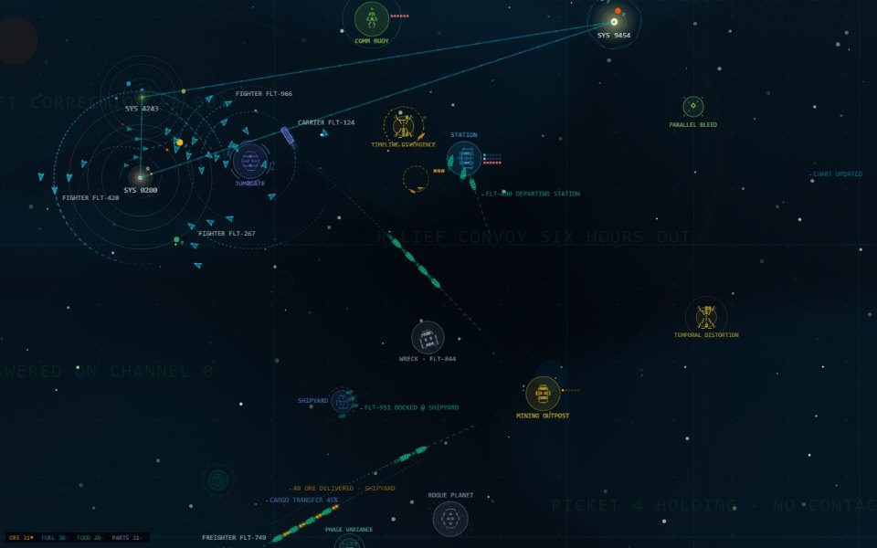

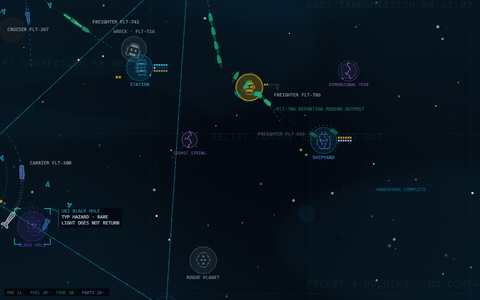

A living tactical chart of a stretch of space:
- **Fleets.** They fly in formation between structures that actually do things. Some fly on the main plane and some deep behind it.
- **An economy.** Mines dig ore, docks refine fuel and parts, and habitats grow food. A station that runs short gets a convoy, with the goods glowing in its pods. Shipyards build only from what they hold, and prices tick in the corner.
- **Gates, police, relays.** Paired gates queue ships, scan them for the toll, and pass them through a visible throat. Raids bring interceptors scrambling from the nearest defense platform. Messages and distress calls cross the relay network as light.
- **A camera with a director.** Now and then it leans in on whatever is happening, such as a raid, an armada, or a capture.
- **Courses and chatter.** Each fleet's planned course is drawn ahead of it, and its real trail behind. Radio lines type themselves out next to whatever they are about. Every half minute, brackets close on a contact while its data types out.
- **Pacing.** A slow tension curve gives the sector quiet stretches and busy ones.

The seed is in the URL (`?seed=orion-harbor-23`), so a link is that exact world.

## Six more universes

The map can belong to any world. A *universe* holds the names, factions, ship classes, structures and their ASCII art, chatter, and the faint words drifting in the background. It also decides **what happens there**. Six hand-written ones come with it, and each plays differently:

<table>
<tr>
<td width="48%">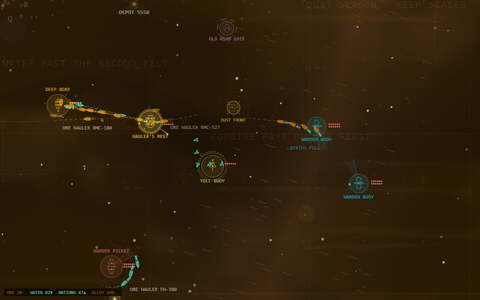</td>
<td><b>Saltwind Reach</b><br>A poor mining frontier at the end of an old road. Belts of rock orbit across the map, and stray rocks collide and shatter. Miners argue over claims and haul ore home in their pods. Warden buoys scan ships, and smugglers bolt with cutters behind them. When a dust front blows through, beams go dark and everyone runs for the docks.</td>
</tr>
<tr>
<td>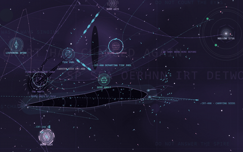</td>
<td><b>Choir of Hollow Stars</b><br>Every star here has been emptied, and something sings inside. A song that reaches another hollow star makes it answer, and the chorus spreads. Leviathans migrate through, and the Mouth reaches for ships with tendrils. The words in the background rearrange themselves. An eye opens in the dark and follows your pointer, and now and then a star goes out for good.</td>
</tr>
<tr>
<td>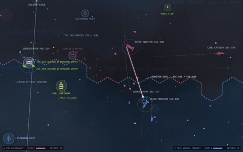</td>
<td><b>The Long Siege</b><br>A war older than anyone fighting it, held hex by hex along a front the camera travels. Each side saves up and then attacks, and supply convoys run to the line while the enemy hunts them. Spotters paint targets before the artillery arcs in, monitors duel, and minefields go off in chains. Now and then a truce holds, and the memorial beacon counts the names.</td>
</tr>
<tr>
<td>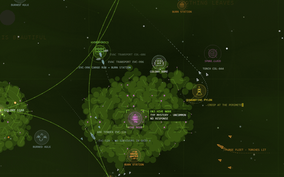</td>
<td><b>Hive Bloom</b><br>Something is growing over the colonies, and it is beautiful. The creep is a cellular automaton that spreads from pulsing hive nodes, and the structures it covers turn to biomass glyph by glyph. Spore flocks swirl out to seed new growth. Colonies evacuate, and purge fleets answer with fire.</td>
</tr>
<tr>
<td>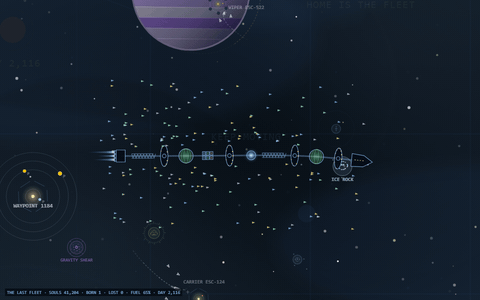</td>
<td><b>The Last Fleet</b><br>Everyone left alive, moving together. A twelve-segment ark crosses the map, with habitat rings whose windows go round, farm domes, and engines trailing plumes. Hundreds of small ships keep station around it. Stragglers fall behind and tugs go back for them, pursuers jump in at the trailing edge, and skimmers dive into gas giants for fuel. Children are born aboard.</td>
</tr>
<tr>
<td>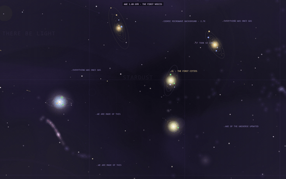</td>
<td><b>Cradle of Suns</b><br>A cosmic time-lapse. Gas collapses, and stars ignite with jets and wind bubbles. Disks clump into planets, and planets light up with cities and send out their first ships. Then come colonies and first contact, and sometimes silence. The age of the universe runs along the top, in billions of years.</td>
</tr>
</table>

## Undercity

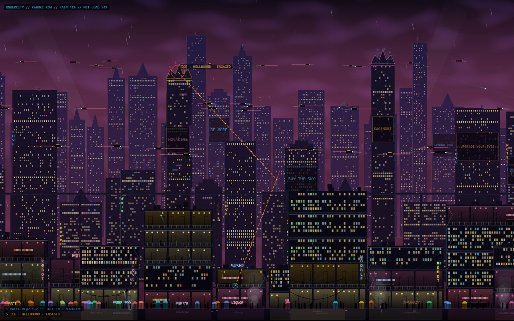

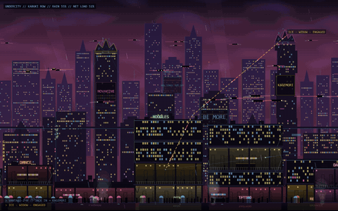

A cyberpunk city at night, in the rain, in 2.5D. Three parallax layers drift past:
- a far skyline of megatowers, with blinking masts and searchlights in the smog
- mid towers, with corp data fortresses and holo ads
- a near megastructure cut open: terraces and markets under lanterns, stairs, cables, and shopfronts over a wet street that reflects the neon

Flying cars stream between the layers in lanes of light. Maglev trains pass, crowds walk under neon umbrellas, and the thunder comes a moment after the lightning.

Over all of it runs the net. A netrunner jacks in, and a trace runs hop by hop to a corp tower, where the ICE wakes in a ring of glyphs. A breach glitches the tower, hijacks its ads, and can take the district's grid down. A flatline brings the police with searchlights.

```ts
mount(document.body, { skin: 'undercity', options: { rain: 1, net: 1.5 } });
```

## Shieldwall

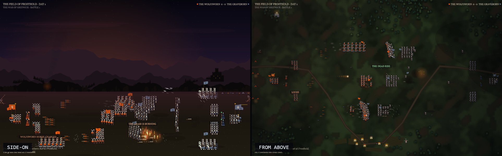

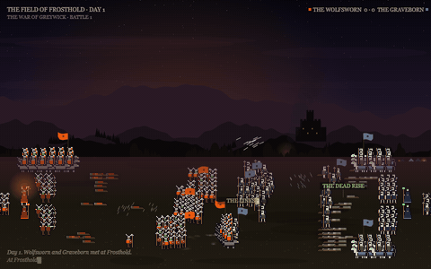

Pitched battles between peoples, in pixel sprites drawn by code. Four peoples, each with its own look, its own magic, and its own way of fighting:
- **a kingdom** of steel and banners, whose mages raise wards against arrows and call sunfire
- **a horde** riding wolves, whose shamans throw fire
- **a fey host** of longbows on elk, whose mages call lightning
- **a hollow legion** of the dead on bone horses, whose necromancers raise the fallen to fight for them

A battle has a story. The armies muster, and sometimes the two lords ride out to duel between the lines. Archers loose volleys that arc across the sky, and trebuchets throw stones. Then the lines advance in ragged blocks and meet, and the horse charges the flanks. A lord rides to a wavering regiment and rallies it, or falls. Morale breaks, a side routs, and the victors hold the field while the crows come down. Days later there is another battle. A war is the best of five, and then a new war begins between new peoples.

Now and then a dragon descends on both armies. It breathes fire along the ranks, and the bows and mages of both sides turn on it. About a third of the time, it falls.

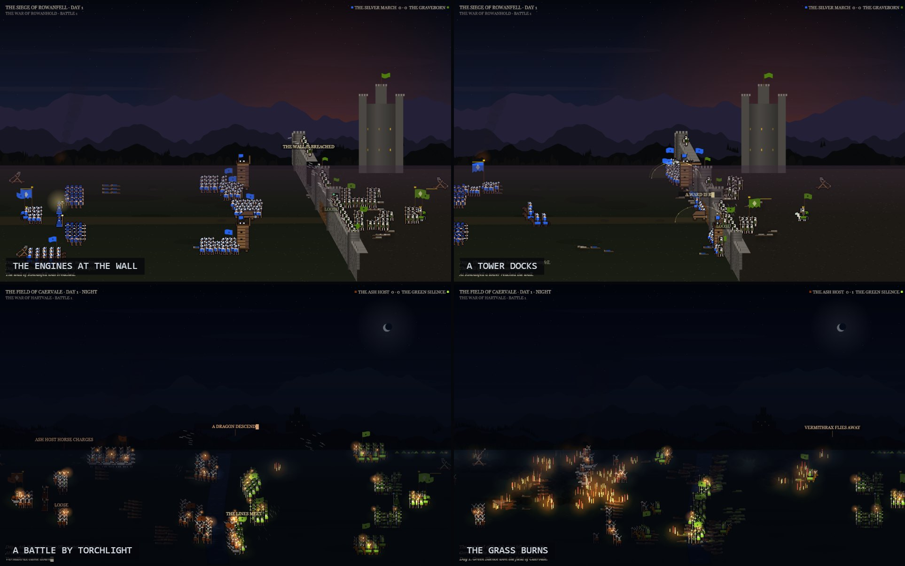

Some battles are sieges. One side holds a walled town, with bows and mages on the wall and a keep behind it. The other side rolls up siege towers and a ram and throws stones until a stretch of wall comes down. Men can cross only where there is a way over: a broken gate, a breach, a tower's bridge, or a ladder (ladders get thrown down). The defenders' foot go to whichever gap opens and hold it. A siege that drags on is given up.

The ground matters too:
- **A hill** gives its holders range for their bows and the downhill blow.
- **A ford** slows whoever is in the water.
- **A wood** at the far edge can hide horsemen, who come out on the flank in the middle of the fight.
- **Dry grass** catches from fire magic and dragonfire, and the fire runs with the wind.

Each side has a standard. Where it flies, the line holds better. If it falls, the wing near it wavers, and sometimes someone takes it up again. The lord's guard goes in when the fight has gone on, or when the line gives.

At night the field is dark but for torches in the ranks, spells, fires, and magelight hung over the enemy. Afterwards the field remembers: the earth is worn where the fighting was, banners lie in the mud, the victors plant theirs, and people come out of the woods to walk among the fallen.

```ts
mount(document.body, { skin: 'shieldwall', options: { view: 'above', dragons: 2 } });
mount(document.body, { skin: 'shieldwall', options: { battles: 'siege', weather: 'night' } });
```

Two ways to watch: `view: 'side'`, a field under a moody sky with mountains, a keep, and camps on the ridge; or `view: 'above'`, the same war as a map at dusk, with woods, a village with its fields and mill, a river and its bridge, and the armies in blocks.

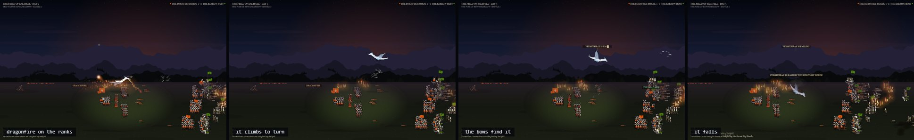

## Ages

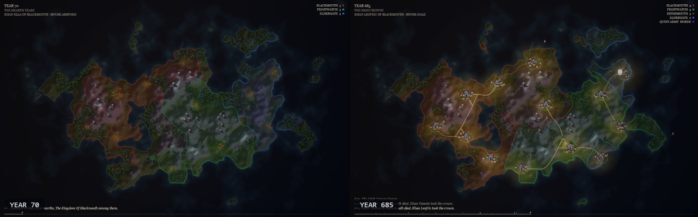

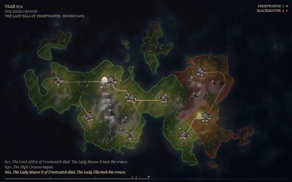

A thousand years of a continent, from above, at dusk. A few peoples light their first hearths. Their settlements grow with the food of the land around them, from hamlet to village, town, city, and capital, and send settlers walking out to found new ones, with roads behind them. Each kingdom's land is its towns' reach, washed in its color, with a border that wanders the way real ones do. The land is drawn from its own height and wetness: hillshade, shallows, a traced coastline, rivers that meander and widen downstream, woods where it is wet, and peaks on the ridges.

Neighbors grow tense along long borders, and in time there is war: armies march along the roads, meet in the field, and sit down outside walls for years. Towns change hands and kingdoms fall. Plague travels the roads. Hordes come out of the wild, and sometimes take a town and settle. Kingdoms grown too big split in civil war, and now and then a dragon wakes in the mountains. When the last era ends, the age ends, and a new land rises.

The ages show in the towns:
- **Eras turn every couple of centuries**, from the Hearth Years to the Lamp Age, and the towns are rebuilt in each one: round huts and palisades, then timber, then stone houses under red roofs, church spires, palaces, and star forts with moats. Ships go from oared galleys to cogs to tall ships.
- **Dynasties:** every kingdom has a ruling house and a ruler, and reigns end. An heir takes the crown, or the house dies out and a new one takes the throne, and a big realm may split over it in a war of succession.
- **Trade:** caravans walk the roads between friendly towns, and ships sail between ports. Rich towns grow past what their own fields could feed, and the busiest roads wear wider.
- **Wonders take a lifetime.** A great city begins one, and it rises for decades under scaffolding and a crane: a lighthouse that turns its beam, a cathedral, hanging gardens, a colossus, a library, a stepped stair of kings, an observatory.
- **The land changes:** woods around the growing towns are cleared for fields, volcanoes wake and bury the towns below in ash, and rivers flood.
- **A ribbon of history** runs along the bottom of the map: the eras, a mark for every war, plague, wonder, and fallen house, and where the age is now.

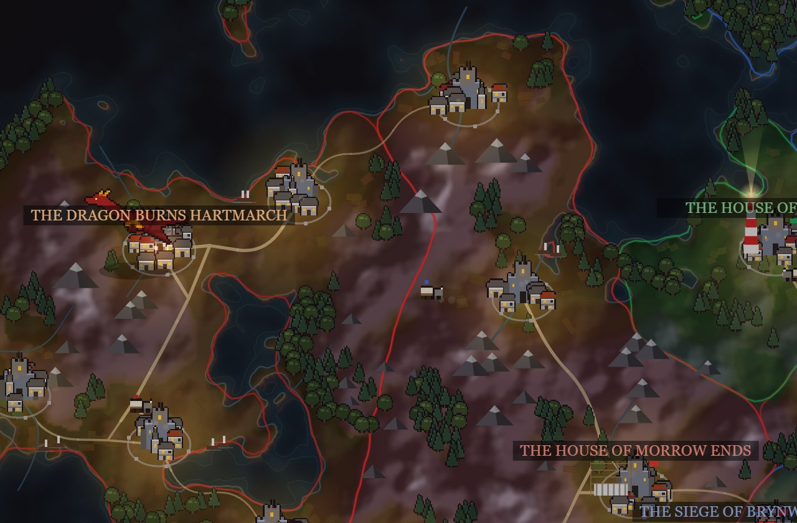

```ts
mount(document.body, { skin: 'ages', options: { speed: 1.5, kingdoms: 6 } });
```

## War table

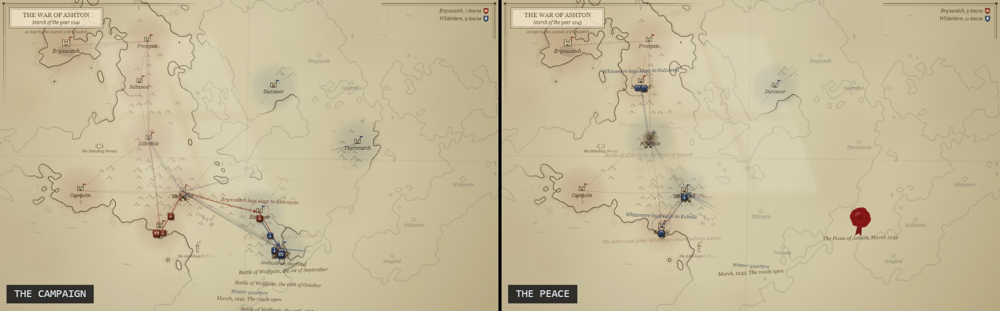

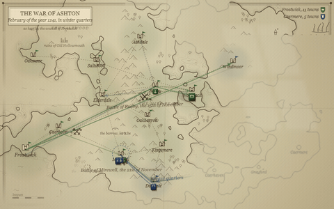

One war's campaign, played out on a parchment map by a hand you never see. The map is drawn in ink: a coast with contour ripples, hatched hills, little woods, dotted roads, castle towns with their names in an italic hand, a compass rose, and a serpent noted in the margin. Two or three realms wash their towns in watercolor.

Each month the orders go out. An arrow is drawn in ink, and then a painted wooden token, stacked by strength and carved with a sword, a horseshoe, or a crown, slides along it. Tokens that meet fight, and the loser falls back or is tipped over. A token left at an enemy town lays siege, and the days are counted in ticks around it until the town falls and its pennant changes color. Battles leave crossed swords and a note with the date, and some towns burn. In winter, frost creeps in from the edges and the armies go into winter quarters. When a realm loses its seat, or everyone is worn out, the peace is sealed in red wax, and the next campaign is unrolled.

There is more on the table than the war:
- **Dispatches.** Sealed letters ride out from each seat to its armies, a dotted line behind them, and are opened when they arrive. A rider who passes too near the enemy may be taken: the seal is broken, the letter read, and the enemy moves on the army it was for. Now and then a letter is a forgery under a stolen seal, and the army that obeys it marches into a trap.
- **The fog of war.** The map is kept by one realm's war council. Around its towns, its armies, and the enemy towns its scouts watch, the map is in ink; beyond that it is bare paper with the coast and towns sketched in pencil, and enemy armies are only where they were last reported, a pencilled square with a question in it.
- **The light of the seasons.** Window light drifts across the table, the mullions' shadow through it: cold and small in winter, fresh in spring, long and golden in summer, amber in autumn, when a few leaves blow in.
- **An old map's furniture:** a double frame and a scale of leagues, rhumb lines from the compass rose, rivers, named peaks, woods, and seas, a witch's tower, ruins, standing stones, a barrow, a kraken and a whale, a wind's head blowing across the sea, and each realm's arms on a shield in the legend.

It is the one light-themed world: dark ink on parchment, legible under dark text.

```ts
mount(document.body, { skin: 'war-table', options: { realms: 3 } });
```

## Wyrmspire

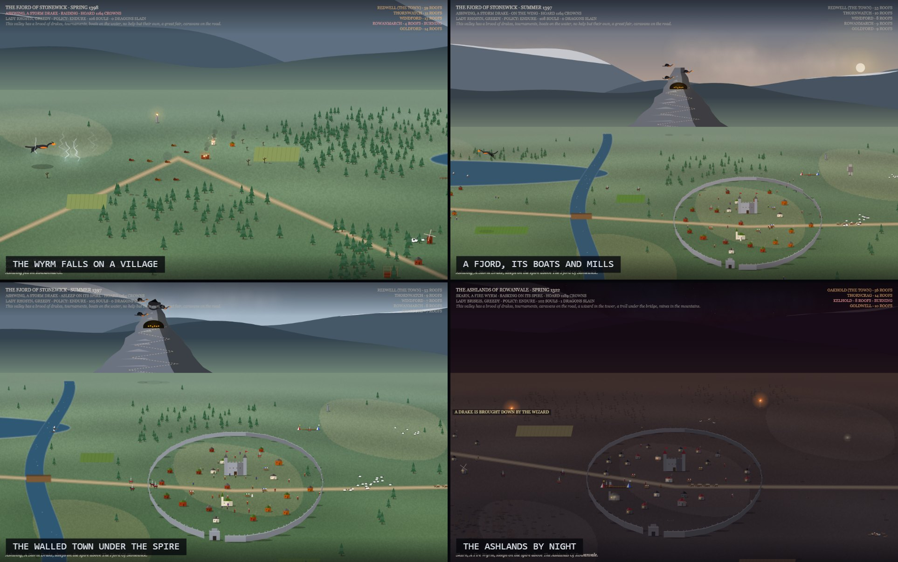

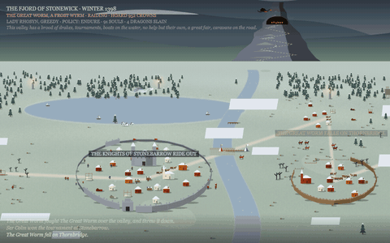

A valley seen in depth from a hillside, wider than the screen. At its far end a spire of rock rises with a cave high in it, a path cut up its face, and the wyrm coiled on top with its brood on the ledges.

The valley is full and busy at any speed:
- a walled town under its castle, with its church, inn, smithy and market
- villages with their fields and windmills, a river and its bridge, forests, pastures and herds, and watchtowers on the hills
- farmers plough, tend and reap with the seasons and cart the sheaves to the granary
- woodcutters fell trees and haul the logs, and builders keep raising houses, churches, granaries, mills, palisades and ballista towers
- shepherds, merchants, caravans, guards on the walls, knights at the lists, and priests at the church

The wyrm basks, patrols and hunts the herds, and its drakes take cattle and harry the villages. When its wrath is up it raids. The beacons are lit from hill to hill and the bells ring, and the people run for the walls. Its breath burns, freezes, calls lightning, withers or darkens, by breed. Fires spread from roof to roof until the bucket chains put them out, and the ruins are rebuilt. Archers loose, ballistae throw their bolts, and the knights ride out.

The lord answers by temper: endure, fortify, pay tribute (carts to the foot of the spire), or hunt. Heroes ride in, feast, and climb the spire path to the cave; thieves go up by night for the hoard.

Each seed draws its land (alpine, fjord, red canyon, fen, ashlands) and breed, and a cast: the brood (drakes, a clutch of eggs, or the wyrm alone), foes (a rival wyrm to fight over the valley, a hill giant, a troll under the bridge), pageants (tournaments, a great fair, pilgrims), trade (mines, boats, caravans), the land's own hazards (avalanches, a smoking mountain, floods), and help (griffon riders, a wizard in his tower). The first version, through a watchtower's spyglass, is `style: 'classic'`.

```ts
mount(document.body, { skin: 'wyrmspire', options: { valley: 'fen', wrath: 2 } });
```

## Deephold

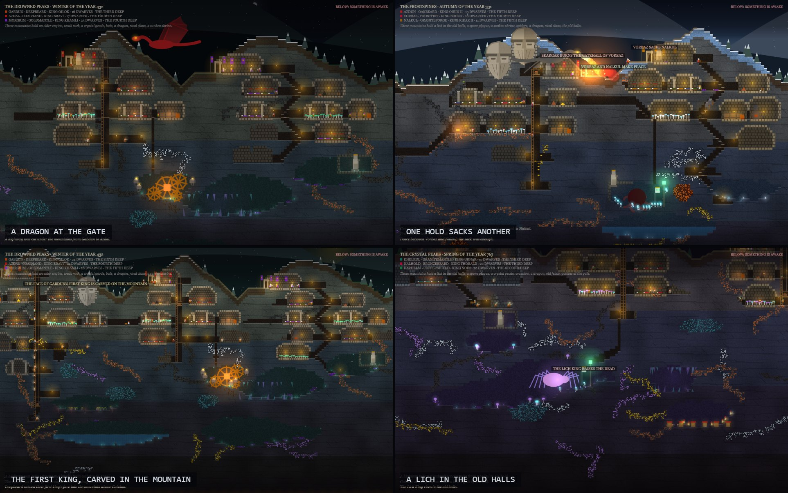

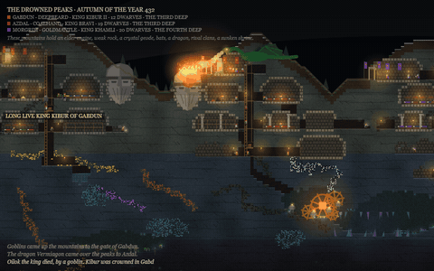

A range of mountains cut through like a glass ant farm, wider than the screen, with two to four dwarf holds inside it, each its own clan with its own banner, king, and way of building:
- how it goes down: ladder shafts, a lift riding its ropes, or flights of stairs that zigzag from deep to deep
- how it carves its rooms: arched, domed, tiered, or vaulted, lined in its own dressed stone or left raw
- how it lights them: torches, braziers, crystal lamps, or lava run in channels
- whether it lays rails, and how many statues of its kings it raises

The holds never stop building. Each has an endless plan: deeper levels, rooms as the clan needs them (storerooms, dormitories, farms, breweries, forges, great halls, temples, tombs, barracks, treasuries, pumps, halls of records), mines along the veins, vaulted halls and galleries of kings, its first king's face carved on the mountainside, and highways under the mountains to the next hold, bridged where they cross a cavern. Dwarves dig fast enough to watch; haulers push carts of ore; smiths, brewers, farmers and masons work; they sleep in shifts and feast. Caravans and migrants come up the slopes, kings are crowned, and a smith in a strange mood forges an artifact.

The holds trade along the highways and fall out: a hold marches its soldiers through the tunnels to sack a rival's hall, then makes peace. A hold emptied falls, and another clan comes to retake it. A dragon comes over the peaks to burn a gate until the crossbows bring it down or it flies off.

Every seed is a different range with its own cast, drawn the way the sector map draws its mechanics:
- **What lies below** (one of these):
  - a sleeper, of many kinds and names, that stirs when they dig near and climbs the shaft
  - a lich in the old halls who raises the dead (the clan's own, from the tombs)
  - an elder engine that wakes and sends out golems
  - a hive queen who sends swarms
  - nothing at all but stone
- **Hazards:**
  - aquifers that flood a deep (the water flows, and pumps drain it)
  - magma that flows and cools to obsidian
  - weak rock that caves in
  - firedamp in the coal
  - a spore plague that spreads from dwarf to dwarf
- **Neighbors:** goblins at the gate, a goblin warren that raids from below, deep gnomes who come up to trade.
- **Wonders:** a crystal geode, a mithril lode, a sunken shrine, the halls of an older people, a black lake.
- **Life in the caverns:** spiders, crawlers, trolls, bats, glow-worms, mushroom folk.
- **The sky:** a dragon, or clear skies. **The clans' temper:** rivals quick to war, allies who trade, or old feuds.

The things below wake when the miners dig near them, break through to the holds, and send their own; they can be ended by the soldiers or wind down. The first version, a single hold under one mountain, is `style: 'classic'`.
```ts
mount(document.body, { skin: 'deephold', options: { mountain: 'ember', holds: '4', below: 'lich' } });
```

## Leylines

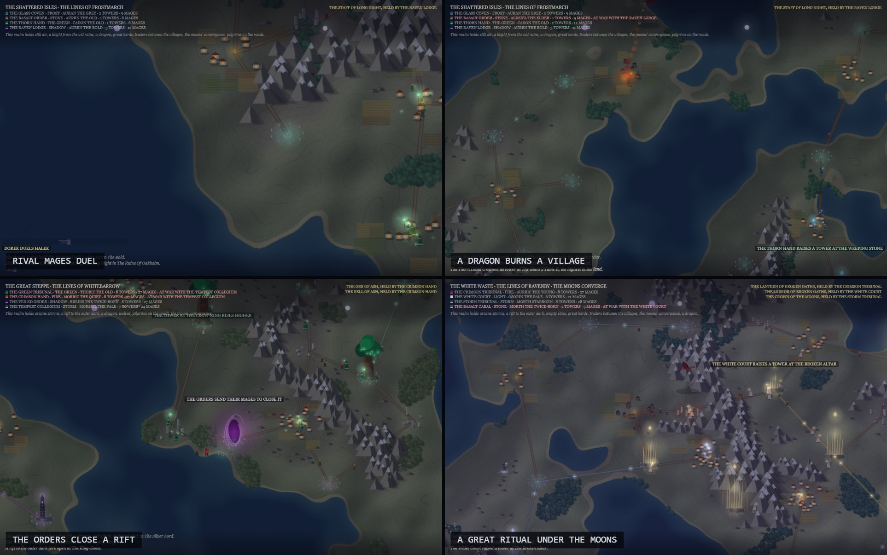

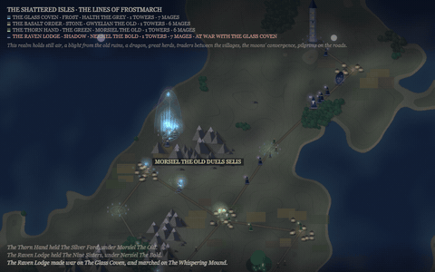

A realm seen from high up, wider than the screen, the way a mapmaker draws it: hills and snowcapped peaks, forests, lakes or sea, villages with their fields and roads, the ruins of an older age, and stone circles on the wells where the ley lines meet. Power runs along the lines into the towers built on them.

Orders of mages hold the wells. Each has a school (fire, frost, storm, the green, shadow, light, stone) that decides its spells and its summons, a tower style (spires, ziggurats, crystal clusters, great trees, obelisks), its colours, an archmage, and a temper. Their mages are out on the land all the time, walking the roads and the lines (storm mages ride the air):
- channelling at their wells
- going out to claim free wells and raising towers on them, stone by stone, then higher
- blessing villages, which grow
- searching ruins for artifacts, and sometimes waking what guards them

Rival mages who meet duel with their school's spells: fireballs, ice lances, lightning, vines, shadow bolts, beams of light, spikes of stone. The spells mark the land, burning the woods and leaving frost. Orders at war send war parties with summoned elementals to besiege a tower until its ward breaks and it falls, and its well is free to claim again. An archmage who falls is succeeded; an order that loses its last tower is gone, and a new one rises at a free well.

Every seed draws its land (a blend of isles, steppe, forest, desert, tundra, fens and peaks) and a cast:
- **Weather:** arcane storms whose lightning charges the towers, long rains, or still air.
- **Calamities:** a rift that pours out demons until the orders close it together, a falling star the orders race to, a blight creeping out of the ruins.
- **The sky:** a dragon that burns villages until the mages bring it down or drive it off, griffon riders, or empty skies.
- **Beasts and folk:** great herds, wolves, giants from the hills, pilgrims, traders between the villages.
- **The moons:** at their convergence an order gathers in a circle for a great ritual (a phoenix, a colossus, a forest raised in a night, a ward of light, a fall of stars). Some seeds also get eclipses.

The night is long and lit: tower windows and crystals, braziers, spells, the lines, the cottages. The light is cheap glow sprites, with no bloom pass. The ink network (`style: 'ink'`) and the first version (`style: 'classic'`) are still there.
```ts
mount(document.body, { skin: 'leylines', options: { land: 'mountains', orders: 5, scale: 1.5 } });
```

## Silent Running

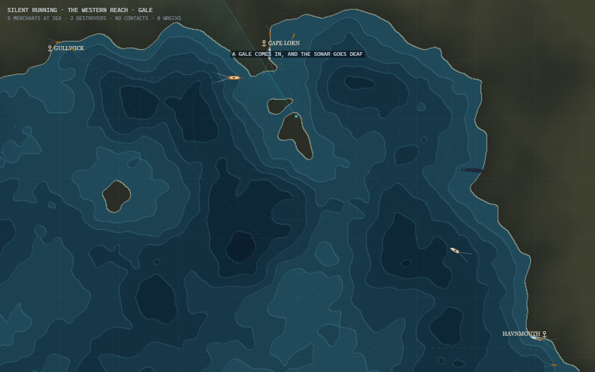

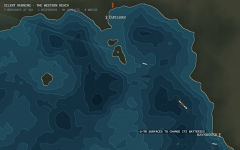

The sonar instrument, grown into a world: a sea at war, on the chart table of a listening station. The chart shows coasts and islands, depth bands, two to four ports, and the shipping lanes between them. The station's sweep turns over all of it.

Convoys of merchants and tankers sail the lanes from port to port, some with a destroyer as escort. Destroyers patrol and ping, and a ping can hear a submarine. Raiders are faint shapes under the water until they are heard. They stalk the lanes, come up to periscope depth, and fire on merchants. A destroyer that hears one hunts it: depth charges over the contact, a decoy, a lost contact, sometimes a kill. Sunk ships stay on the chart as named wrecks, with an oil slick that drifts. Whales migrate through the sound and sing, and now and then a destroyer mistakes one for a boat.

Each seed draws its sea (which coasts, which islands, which ports) and a cast: raiders, a wolfpack that gathers on the lanes, gales that make the sonar deaf, ice in the north, and, very rarely, something far too large for any boat passing under the lanes. A click drops a sonobuoy: it listens for half a minute, and if it hears a submarine, the nearest destroyer comes.
```ts
mount(document.body, { skin: 'silent-running', options: { traffic: 1.5 } });
```

## Foundry

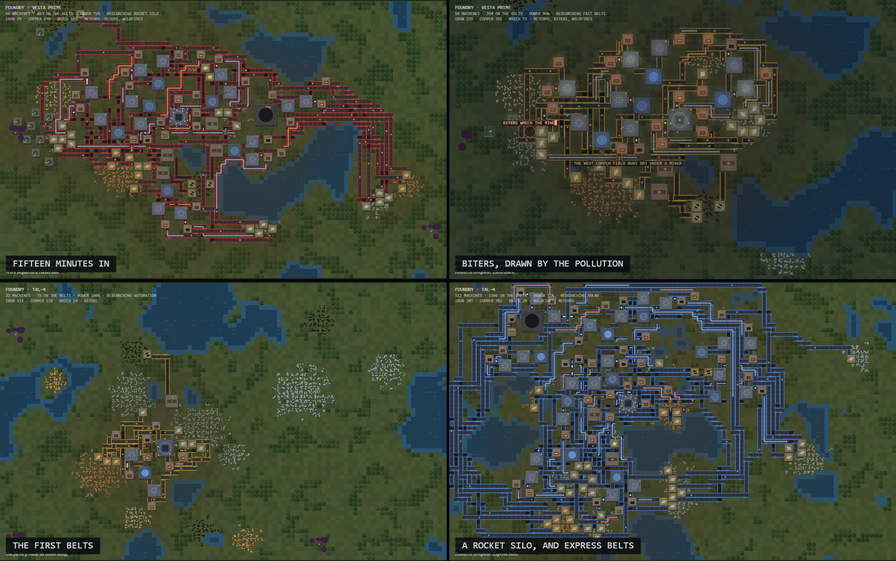

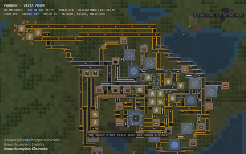

A factory that builds itself, seen from above. A headquarters lands on a seeded planet of grass, lakes, woods, and ore fields: iron, copper, coal and stone. Construction bots fly out from it, lay belts tile by tile, and raise machines. The belts fill with ore, plates, gears and circuits.

One rule does most of the growing: a machine missing an input gets a supplier. A lab needs gears and circuits, so assemblers go up beside it. An assembler needs plates, so furnaces follow. A furnace needs ore, so a miner goes up on the nearest field, with a belt back. The headquarters keeps its own supply lines, because everything is paid for from its stock. The boilers keep up with the machines, more labs come with research and with iron to spare, and a rocket silo comes when enough has been researched. Ore runs out under a miner, so it is taken down and another goes up elsewhere, and the belts are rerouted all the time. Research never ends, and fast and express belts change colour as they arrive. Rockets launch.

Each seed draws its land and a cast: biters in nests at the edge, drawn by the pollution (they wreck what they reach and go home; the factory answers with turrets), wildfires in the woods, and meteors that leave new ore in their craters. Smoke rises from the furnaces, and at night the factory is lit. A click on an ore field orders a new mine; a click on a machine puts it on overtime.
```ts
mount(document.body, { skin: 'foundry', options: { pace: 1.5 } });
```

## Brasswind

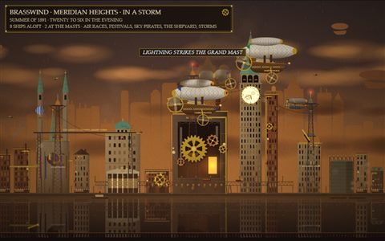

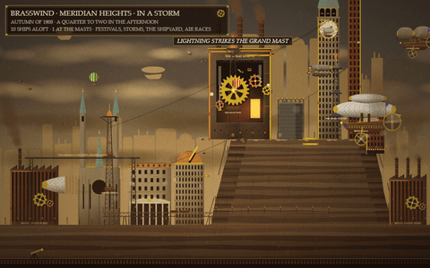

A skyport city of brass and steam, seen from across the river. Airships come in to the mooring masts, unload, and leave. Trams cross the viaducts, cable cars and pneumatic capsules run between the towers, and the city builds itself higher a floor at a time. A day is four minutes, and the seasons and the years turn. Each seed draws the city's site (a crag, a canal, or stacked decks), its name and year, and three to five events from: sky pirates chased by the Admiralty's corvettes, storms on the masts, air races round the spires, festival fireworks, a hull that grows in the shipyard until it launches, a walking engine, and a great comet.
```ts
mount(document.body, { skin: 'brasswind', options: { traffic: 1.5 } });
```

## Ironhaze

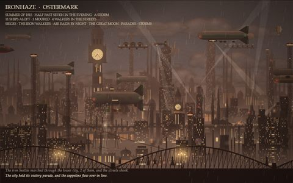

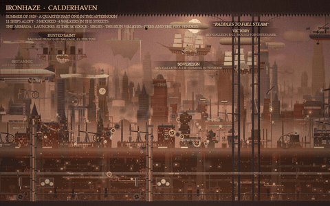

A city of iron and smoke in five planes of fog, painted like a matte painting and tinted by the hour. The view drifts sideways forever through a city streamed from the seed, and every so often the Great Spire passes with its clock, whose automata come out at noon. Airships of a dozen kinds come and go at every depth, trains run on the viaduct, and foundries pour. Each seed draws the city's layout (canyon, harbour, heights, or tiers), its mood and name, where you stand (a balcony, a station, a bridge, a gantry), and five to seven events from: fleet battles, night air raids, walkers at the gates, armadas, a walking fortress, a floating citadel on its chains, parades, sky lanterns, a district on fire, workers rising with red flags, storms, a pea-souper, and a great moon.
```ts
mount(document.body, { skin: 'ironhaze', options: { speed: 0.6 } });
```

## Sandsea

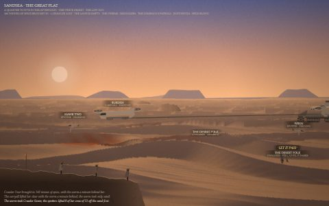

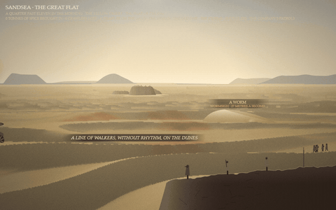

The open sand, seen from a rock ledge with watchers on it. Spotters find spice, a carryall sets a crawler down on the stain, and the crawler works until the carryall lifts it away full, unless wormsign comes first and the lift is too late. The desert folk cross the near dunes, and the day (sixteen minutes) ends under two moons. Each seed draws the colour of the air, the region, and three to five events. Worms are always in the cast; the rest come from sandstorms, smugglers by night, the Company's patrols, riders on a worm at dawn, spice blows, dust devils, the folk stripping a wreck, and, very rarely, the old one rising at the horizon.
```ts
mount(document.body, { skin: 'sandsea' });
```

## Windtrap

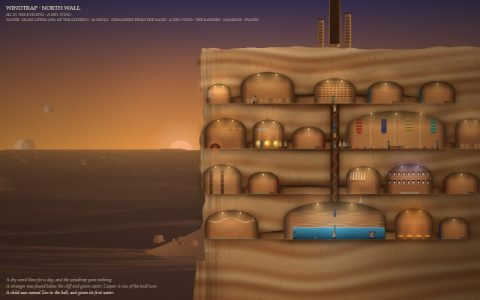

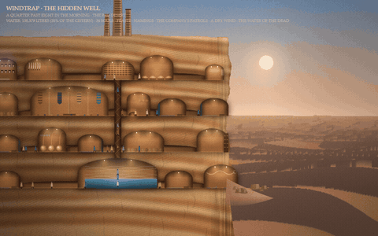

A hold of the desert folk cut into a cliff, in cutaway, with the open desert beside it. The windtrap stands on the cliff top and the cistern at the bottom, and the people work, eat, learn, and sleep in the chambers by the hours of a fifteen-minute day. Dew fills the cistern at dawn, everyone drinks from it, and the water count is read at dusk; when it runs low, rations are halved. Each seed draws the cliff, the hold's name, its chambers, and four to six events from: raids out at dusk and back by dawn, the Company's patrols (every lamp goes out), storms that seal the doors, a dry wind, smugglers at the gate, worm riders, namings, funerals where the water of the dead goes to the cistern, strangers from the sand, the hidden garden coming into leaf, and feasts.
```ts
mount(document.body, { skin: 'windtrap', options: { people: 1.5 } });
```

## Walking Castle

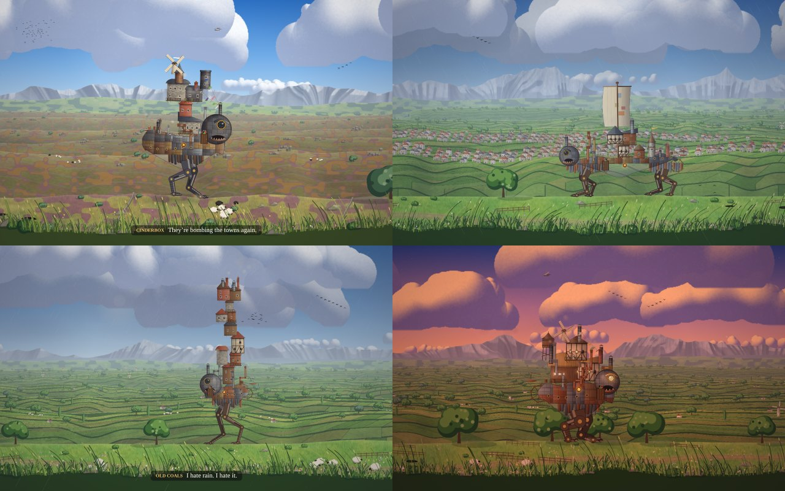

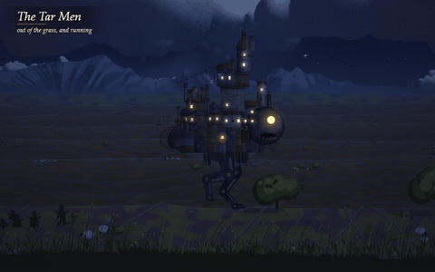

A wizard's ramshackle castle on iron hen's legs, walking across painted country, seen from the next hill. The land scrolls under it in five planes through meadows, moors, lakes, coasts, mountains, flower fields, and towns, each with a title card. The household goes about its day on the balconies, the fire spirit in the hearth talks in subtitles, and the door's dial turns to open on a port, a royal city, a flower field, or a city at war. Each seed draws the homeland and season, the castle itself (a heap, a tower, a barge, or a farm, with its own roofs and colours), and four to six events from: the war fleet bombing a far town, tar men in pursuit, storms and showers that end in rainbows, a lake at sundown, a mountain top, market day, falling stars, fireflies, and another walking house on the road.

`view: 'map'` is the same walk on a traveller's map in ink and watercolour, with the road walked so far in red ink and the diary in the corner.

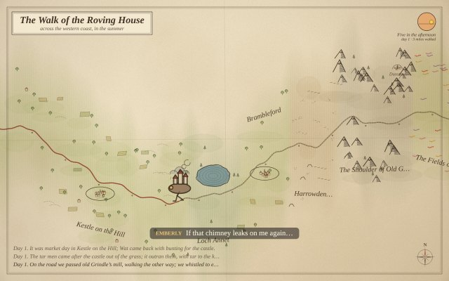
```ts
mount(document.body, { skin: 'walking-castle', options: { view: 'map' } });
```

## War Rig

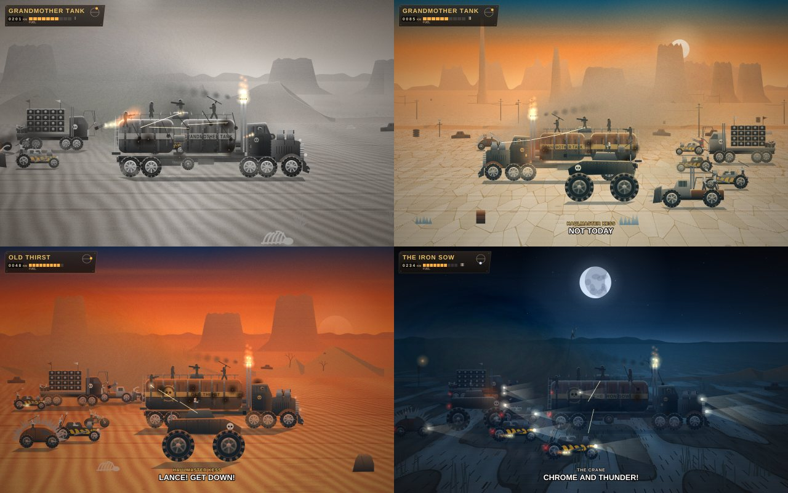

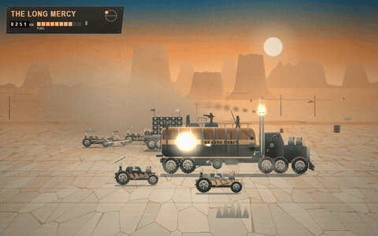

A tanker truck runs across the wasteland with a war party on its tail, seen side-on with the whole chase in frame. Hot rods, ram trucks, bikes, and buggies jockey in the dust, trade gunfire and explosive lances with the rig's crew, and ram its flanks. A car hit enough flips and burns and is left behind, and another comes up from the rear. The chase comes in waves, up to an all-out assault, then the dust settles, and there is a lull at first light. Each seed draws the colour grade, the rig and its cargo (fuel or water), the clans, the regions of the road, and four to seven events from: boarders on sway poles, ram trucks, spiked cars, buggies, the war-drums truck with its flame-throwing guitar, toxic storms, canyon ambushes, a bog by night, a rival clan, a drifter who fights beside the rig, and the warlord's own car.

`view: 'map'` is the chase from overhead, with braided tyre tracks, dust wakes, and long shadows.

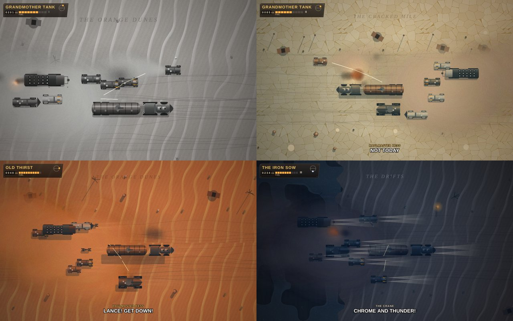
```ts
mount(document.body, { skin: 'war-rig', options: { traffic: 1.5 } });
```

## Traction

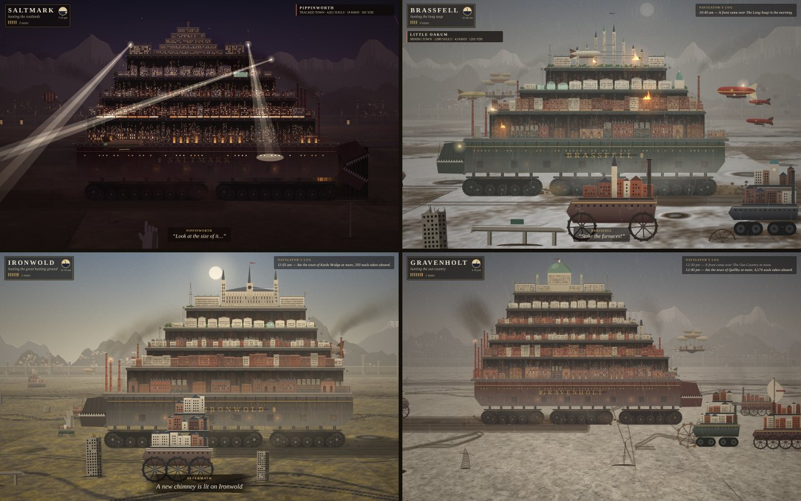

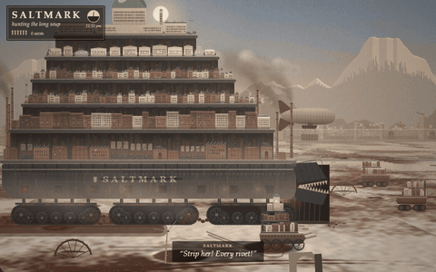

Predator cities on tracks, hunting across a churned-up plain, seen from alongside as if from a scout airship. A colossal city of stacked tiers grinds through the mud. When it sights a town it sounds its horn and gives chase, and either takes it in its jaws (the town is stripped in the gut, and a new chimney is lit) or loses it over the ridge. Airships, trader balloons, and crows go overhead, and the ruins of the ancient world lie in the mud. Each seed draws the air and the land (mud, salt, steppe, or snow), the city's crown, tiers, and tracks, the names, and four to six events from: raids by the Accord's airships, a duel with a rival city, the shield-wall's guns, weather fronts, searchlights at night, breakdowns, a sky harbour, a relic heaving up out of the mud, scavenger towns, and herds of suburbs.

`view: 'map'` is the navigator's survey chart of the same hunt: the city in plan, the towns as named symbols, the pursuit in red, and pencilled notes where things happened.

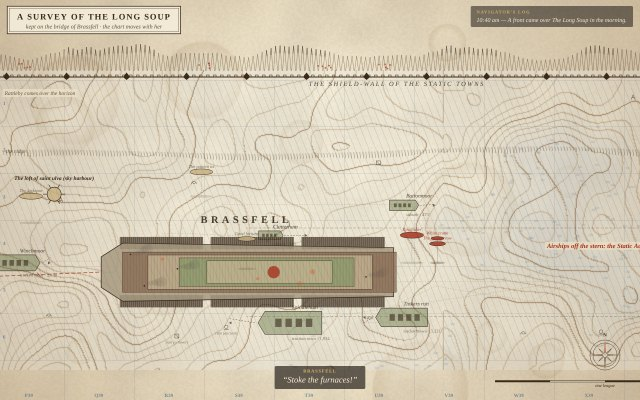
```ts
mount(document.body, { skin: 'traction', options: { view: 'map' } });
```

## Last Loop

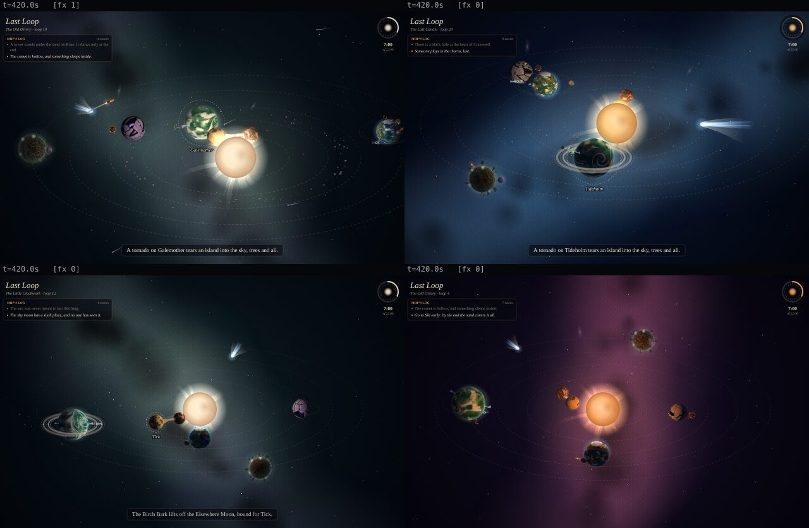

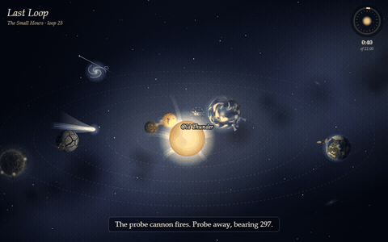

A tiny handmade solar system, like a model on a desk, in the last twenty-two minutes before its sun goes supernova. A wooden ship flies from the wooded homeworld to five to seven places each loop, and writes a line in its log at each. The hourglass twins pour sand into each other, a crumbling world falls into the black hole at its heart, and travellers play music by their campfires. At the end the sun collapses, the shockwave crosses everything, the dark comes, and the traveller wakes by the fire to begin the next loop. Each seed draws the star, the orbits, and the names, and a cast that always has the probe cannon and a moon that moves when no one is looking, plus some of: meteors, lights in the thorn fog, tornadoes on the ocean giant, hard landings, solar flares, a signal from a far camp, and rare ones such as falling into the black hole and coming out of a white hole.

`view: 'map'` is the system drawn from above in the back of the ship's log, with the loop clock round its rim and the bearings of past loops' probes.

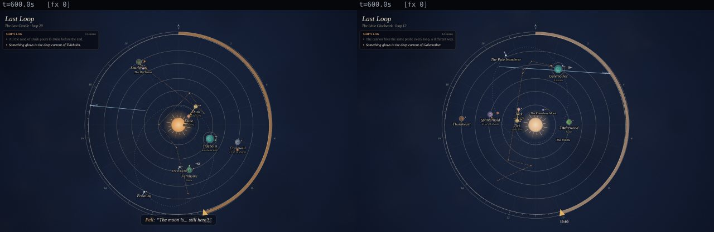
```ts
mount(document.body, { skin: 'last-loop', options: { loop: 10 } });
```

## Blockade

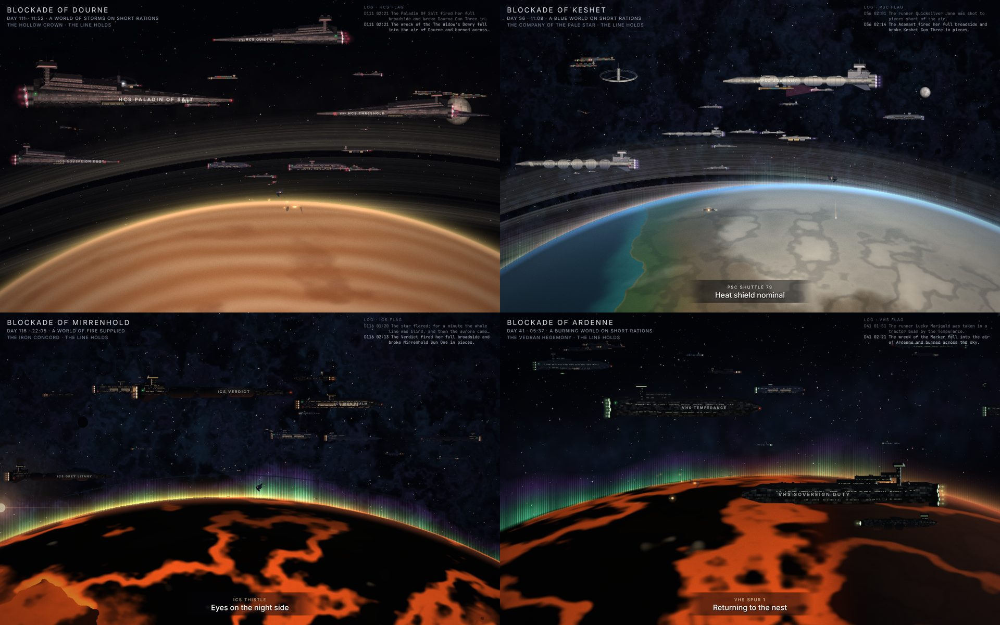


A fleet holds a planet under blockade, seen from high orbit, looking down the line of ships toward the lit limb. Capital ships hold station, frigates patrol, fighter wings loop, shuttles burn down into the air, merchants are scanned at the picket, and a station grows in its frame. The planet turns through day and night, and the blockade wears on the planet's stores and anger and on the fleet's resolve, which decide when the big events come. Each seed draws the planet (ocean, desert, ice, gas giant, lava, or a capital world), its star, moons, and rings, the blockading fleet and its style of hull, and five to seven events: blockade runners always, plus some of sorties, jumps, broadsides, bombardment, solar flares, eclipses, convoys, the planet's great gun, the flagship's pass, salvage, and defections.

`view: 'map'` is the flagship's orbital plot of the same blockade, from above the pole, with stores, anger, and resolve as gauges.


```ts
mount(document.body, { skin: 'blockade', options: { view: 'map' } });
```

## Titan Dock


A giant-robot defence base on a stormy coast, cut open like a section drawing, with the city across the bay and the rift glowing far out at sea. Crews and cranes refit the mechs in their bays while the breach clock counts down. At zero the alarm sounds, a monster surfaces, the door rolls up, and helicopters carry the fittest mech out on cables and drop it in the surf. It kills the monster, blows its reactor to take it down, or is lost, and afterwards it is mended or rebuilt. Each seed draws the mood, the setting (a harbour, a fjord, a refinery, or an island), the mechs (names, builds, liveries, weapons), which monsters this coast gets, and four to six events from: squalls, sea fog, convoys, bone merchants, weapons tests, refits, double events, skitters on the beach, fireworks, the rift lab, whales, and shelter drills.

`view: 'map'` is the defence command's radar plot of the bay, with each monster's projected course to the harbour.


```ts
mount(document.body, { skin: 'titan-dock', options: { view: 'map' } });
```

## Saber Front


A ground battle of the Clone Wars, seen from a ridge as a wide diorama. Clone troopers and battle droids trade bolts from cover, walkers and tanks hold behind the lines, gunships and landers bring reinforcements, and fighters and capital ships fight overhead. The battle runs in engagements: a build-up, a clash, a climax (the walkers go in, a Jedi leads a charge, gunships come in low, the shield generator is blown), and an aftermath, and the front moves back and forth without ending. Each seed draws one of eight battles (Geonosis, Christophsis, Felucia, Umbara, Kamino, Ryloth, Kashyyyk, or the hangar of the Invisible Hand), its hour, the legion and the Jedi, and four to six events from: the Jedi, a duelist, droidekas, spider droids, a shield generator, broadsides, a Venator's descent, bombing runs, storms, and illumination flares.

`view: 'map'` is a commander's holo-table of the same battle, with the front a glowing line between blue and amber.


```ts
mount(document.body, { skin: 'saber-front', options: { field: 'kamino' } });
```

## Instruments from other worlds

The same idea, applied to other screens.

| | |
| --- | --- |
|  **Sonar.** A submarine's passive waterfall. Contacts drift across bearings, and whales sing on and off. Then a torpedo is in the water: the boat turns hard and every trace bends with it, a decoy blooms, and the torpedo veers off after it. |  **Approach radar.** The sweep paints aircraft onto fading phosphor. Arrivals hold, land, or go around, departures climb out, and conflict alerts blink. Now and then someone declares an emergency and squawks 7700. |
|  **Seismograph.** Station pens tremble until a quake's waves sweep down the stack. Big ones bring aftershock sequences. Quarry blasts, volcanic tremor, and great quakes from the far side of the planet that reach every station at once. |  **Abyssal scanner.** Marine snow and bioluminescent animals. A startled jelly's alarm flash runs through its neighbors, and a dragonfish hunts by red light. Something very large crosses the edge of the light. |
|  **Martian weather radar.** Dust storm cells drift over Jezero. A rover drives and cores samples, a helicopter scouts ahead, meteors leave fresh craters, and storm watches park everything. It all goes into the ops log. |  **Petri dish.** Artificial life under a fluorescence microscope. Particles of six strains pull on and push each other by a seeded rule, and from that alone, cells form with membranes, crawl, divide, and swallow each other. The instrument tracks specimens and logs it all. A technician adds nutrient drops, the medium shifts and a strain adapts, an antibiotic disk clears a zone, and very rarely something enormous drifts through. |

### The Petri dish, up close


The life in the dish has to eat. The agar holds food that slowly regrows. Cells take it up and drift toward where there is more, and where it runs out they fade and die. The dead rot back into the agar, and spores come up where there is food again.

One strain hunts. The others flee it, and what it catches it eats, turning prey into more of itself when it is well fed. It also starves fastest, so its numbers boom and crash. Now and then something gets in at the rim, a contaminant that converts what it touches, until the technician puts it under the UV lamp.

The microscope behaves like one:
- The focus drifts as the stage warms, and the autofocus hunts back to sharp.
- The stage pans slowly to keep the action in the eyepiece.
- There are three stains: `fluorescent`, `darkfield`, and `phase` contrast, which shows dark bodies with bright halos.
- The lab notebook gives every organism a Latin name (a genus per strain, an epithet each, now and then one named for the sample) and notes what it saw, beside a chart of each strain's numbers over the last two minutes.

`medium: 'lenia'` swaps the particles for a Lenia culture, a continuous cellular automaton (Bert Chan's) run with FFT convolutions. Its creature is Orbium, a glider that looks alive. They swim out of the eyepiece and back in, and they meet: two may merge, break apart, dissolve, or set off an overgrowth that fills the field, which the technician dilutes before inoculating again.

## Basics

Not every site wants a story. Calm presets for product pages are built from the same layer library, tuned behind real text:

| calm-mesh | aurora-night | terminal-rain | fireflies |
| --- | --- | --- | --- |
|  |  |  |  |
| **deep-field** | **flow-lines** | **paper-grid** | **nebula-drift** |
|  |  |  |  |

*Every image on this page was rendered by the engine at a fixed seed, so the same seed paints the same pixels on every run.*
